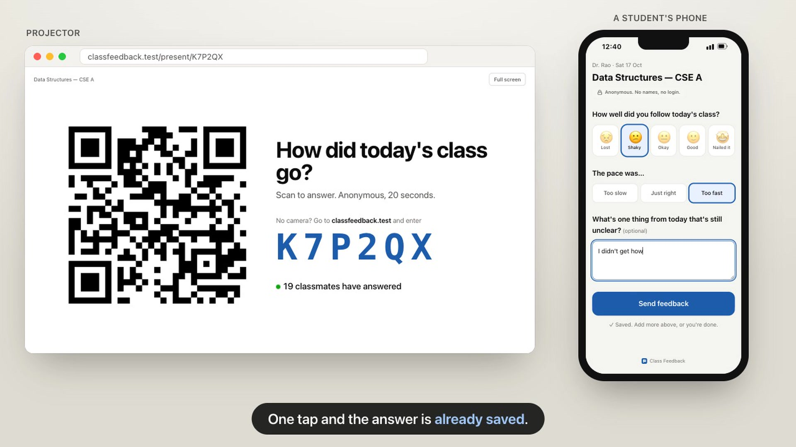
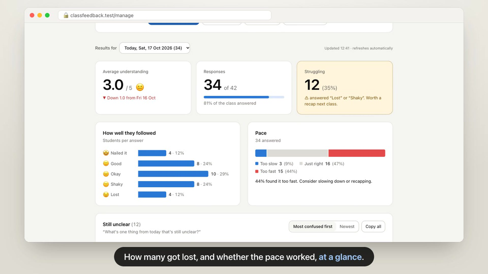
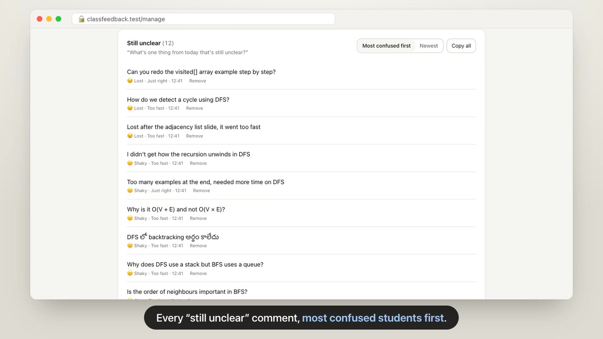

# Class Feedback

Anonymous feedback after every class, in under 20 seconds.

A teacher creates a course once and puts one QR code on their last slide. Students scan it and answer three questions, and the teacher sees the results within seconds. Nobody needs an account.

[](https://vercel.com/new/clone?repository-url=https%3A%2F%2Fgithub.com%2FNADTEST45%2Fclass-feedback&project-name=class-feedback&repository-name=class-feedback&env=DATABASE_URL&envDescription=Postgres%20connection%20string%2C%20e.g.%20Supabase%20%E2%86%92%20Connect%20%E2%86%92%20Transaction%20pooler&envLink=https%3A%2F%2Fgithub.com%2FNADTEST45%2Fclass-feedback%23deploy)

**▶ [Watch the 68-second demo](docs/class-feedback-demo.mp4)**

| In class | Teacher's results |
| --- | --- |
|  |  |



| For | What they do |
| --- | --- |
| **Teachers** | Create a course (name, optional class size) → get a private dashboard + a QR/slide that never changes → show it in the last 2 minutes of class → read results. |
| **Students** | Scan the QR (or type the 6-letter code) → tap a face → optionally pick pace and write what's unclear. |

The three questions:

1. **How well did you follow today's class?** Five faces from Lost to Nailed it.
2. **The pace was…** Too slow, just right or too fast.
3. **What's one thing that's still unclear?** Optional free text. The teacher can change the wording.

## Why it's hard to break

| Problem in real classrooms | What the app does |
| --- | --- |
| Students give up on long forms | Three questions. The **first tap is saved immediately**, even if they close the page. |
| Same student answers twice | One response per browser per class. Changing an answer updates it (a random id kept in localStorage and a cookie, hashed server-side). |
| Spotty campus Wi-Fi / mobile data | Answers that fail to send are kept on the phone and retried every 15 seconds while the page is open (a stalled request times out after 10), and again if it's reopened by the next day. A tab left open from an earlier class reloads to today's form. |
| Teacher forgets to make a new form each class | One QR all semester. Responses are filed under the class day automatically (in the teacher's timezone). |
| Form opened at 11:59 pm, sent after midnight | Answers are filed under the class day the form was opened on (up to one day back), so they still count for that class. |
| Teacher loses the link | The browser that created the course remembers it under "Your courses". Other devices only remember it if the teacher chooses to, with a **Forget** button for shared PCs. There's also "Copy private link" and "Email it to myself". |
| Fear of being identified | No names, emails or logins are collected. IPs are kept only as keyed hashes for spam limits, and wiped after 2 days (checked hourly). |
| Spam / scripts | Strict validation, a 16 KB request limit, and JSON-only requests, so other websites can't submit on their visitors' behalf. A per-network cap per class: twice the class size (at least 60) when known, at most `MAX_RESPONSES_PER_IP` (400), so a whole class on one Wi-Fi is fine. A per-network limit on new courses. Teachers can **remove** any response. |
| Comments pasted into Excel run as formulas | The CSV export neutralises `=`, `+`, `-`, `@` and includes a BOM so Telugu, Hindi and other scripts open correctly. |
| QR shown from a laptop on `localhost` | The dashboard and projector view warn that phones can't reach `localhost`. |

## Run it locally (zero setup)

```bash
npm install
npm run dev
```

Open http://localhost:3000. Without `DATABASE_URL` the app uses an embedded Postgres (PGlite) stored in `./.data/`, so you don't need to install a database.

> Phones can't reach `localhost`. To try it with real students, deploy it (below) or run it on a machine whose address phones can reach and set `NEXT_PUBLIC_SITE_URL`.

## Deploy

Recommended: Vercel + Supabase (both have free tiers). Use the **Deploy with Vercel** button above, or do it by hand:

1. **Database:** create a Supabase project, then **Connect → Transaction pooler** and copy the connection string (port `6543`). Any Postgres works. TLS is required unless the URL sets `sslmode` (e.g. `?sslmode=disable` for a server on your own network).
2. **App:** fork or clone this repo, import it in Vercel, and add the environment variable `DATABASE_URL` = that connection string. Deploy.
3. **Check:** open `https://<your-app>/api/health`. It should return `{"ok":true,"database":"postgres"}`.

Tables are created automatically on the first request. Row-level security is switched on, so Supabase's public REST API can't read the data. The app connects as the table owner.

### Or self-host on a college server

Needs Node.js 20.9 or newer.

```bash
npm ci
npm run build
npm start            # port 3000; put it behind your HTTPS reverse proxy
```

Data lives in `./.data/` (back it up), or point `DATABASE_URL` at your own Postgres.

Put the app behind a reverse proxy (nginx, Caddy, …) that appends the client address to `X-Forwarded-For`. In nginx that's `proxy_set_header X-Forwarded-For $proxy_add_x_forwarded_for;`. The spam limits use that entry, and clients can't fake it. With more than one proxy in front, set `TRUSTED_PROXY_HOPS`.

### Environment variables

| Variable | Required | Purpose |
| --- | --- | --- |
| `DATABASE_URL` | On Vercel / serverless | Postgres connection string. TLS is required unless the URL sets `sslmode`. Omit to use the embedded database. |
| `NEXT_PUBLIC_SITE_URL` | No | Public URL used in QR codes, e.g. `https://feedback.yourcollege.edu`. Defaults to the address in the browser. Read at build time, so rebuild after changing it. |
| `IP_SALT` | No | Secret key for hashing IPs. If unset, a random one is generated once and kept in the database. |
| `TRUSTED_PROXY_HOPS` | No | How many of your own proxies append to `X-Forwarded-For` (default 1). Ignored on Vercel. |
| `MAX_RESPONSES_PER_IP` | No | Upper limit on responses per network per class (default 400). |
| `MAX_COURSES_PER_IP_PER_HOUR` | No | New courses per network per hour (default 30). |
| `PGLITE_DIR` | No | Where the embedded database is stored (default `./.data/pglite`). |
| `DATABASE_POOL_SIZE` | No | Postgres connections per instance (default 5). |

## How it's built

- Next.js 16 (App Router, Cache Components) + Tailwind CSS 4, TypeScript.
- Postgres via `postgres` (production) or PGlite (local); one SQL code path in [`lib/db.ts`](lib/db.ts).
- No accounts: each course has a random private key. Only its SHA-256 hash is stored, and it travels in the URL **fragment** (`/manage#k=…`), which browsers never send to servers or logs.

```
app/
  page.tsx                 home: join with code, create course, your courses
  f/[code]/page.tsx        student form
  present/[code]/page.tsx  projector view (QR + live count)
  manage/page.tsx          teacher dashboard (key in URL fragment)
  api/courses              POST create course
  api/respond              POST create/update a student's answer (upsert)
  api/manage               GET results · PATCH settings · DELETE course or one response
  api/manage/export        GET CSV
  api/live/[code]          GET today's count (public)
  api/health               GET database check
components/                UI (FeedbackForm, Presenter, dashboard/*)
lib/                       db, server helpers, shared types/labels, QR + slide export
```

## Known trade-offs

- One "class" per course per day. A teacher who teaches two sections should create two courses.
- A determined student could answer twice by switching browsers or clearing site data. The per-network cap limits abuse, and teachers can remove responses, but this isn't identity-grade.
- If the private link is lost on every device, the course can't be recovered. That's the cost of no accounts.

## Demo video

[`docs/class-feedback-demo.mp4`](docs/class-feedback-demo.mp4) is recorded from the real app by [`demo-video/`](demo-video/). It seeds a throwaway embedded database (never `DATABASE_URL`), drives Chrome with Playwright, and encodes 1080p H.264 with ffmpeg. The video always shows the placeholder address `classfeedback.test`. To re-record after changing the UI:

```bash
npm run build
cd demo-video && npm install && npm run record   # needs Google Chrome and Node 22.18+; writes demo-video/out/
```

## License

[MIT](LICENSE)
